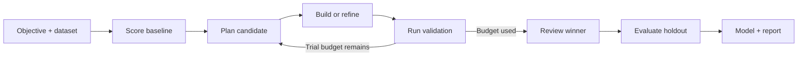

# InternAgent for Claude Code

[](https://code.claude.com/docs/en/plugins)
[](https://nodejs.org/)
[](https://github.com/rexkwoncode/internagent-claude/actions/workflows/tests.yml)
[](LICENSE)

**Build, compare, and refine ML models from a Claude Code session.** Start with a local dataset and an objective. Claude proposes and implements candidates, and a local runner records their scores and keeps the run resumable. Use your existing Claude subscription sign-in with no API key.

[Quickstart](#quickstart) · [Commands](#commands) · [Your own task](#prepare-a-model-task) · [Upstream components](#upstream-components) · [Contributing](#contributing)

## How it works



The search starts with independent drafts, refines promising candidates, and can debug failed trials or combine complementary changes. Each trial saves its source, measured score, parent candidates, and evaluator logs. You can resume after closing Claude Code.

## Quickstart

Install [Claude Code](https://code.claude.com/docs/en/setup) and [Node.js 20+](https://nodejs.org/). Start Claude Code from your ML project directory, then add the marketplace and install the plugin.

```text
/plugin marketplace add https://github.com/rexkwoncode/internagent-claude.git
/plugin install internagent@internagent-claude
```

The marketplace is publicly available over HTTPS. Anyone can install the plugin without a GitHub account. Model calls use your Claude Code sign-in.

The same install is available from a shell.

```shell
claude plugin install internagent --marketplace https://github.com/rexkwoncode/internagent-claude.git
```

For subscription use, check that `claude auth status` reports `authMethod: claude.ai`. If your shell normally sets an Anthropic API key or uses a custom provider, launch from a shell configured for Claude subscription sign-in. The plugin inherits Claude Code's authentication, model, usage limits, and permissions.

Try the bundled example inside Claude Code.

```text
/internagent:run demo
```

One verified five-trial run on the synthetic regression task reduced validation MSE from **10.8818** to **0.00317**, with **0.00339** on the holdout. Candidate choices and scores can vary between runs.

To update, refresh the marketplace in `/plugin` and update `internagent@internagent-claude` from the Installed tab. For local development, clone the repo and launch `claude --plugin-dir /path/to/internagent-claude`.

## Commands

| Command | What it does |
| --- | --- |
| `/internagent:run demo` | Fit a nonlinear synthetic regression with five trials and a fixed holdout. It uses only Node.js for training and scoring. |
| `/internagent:build <objective, data, target, metric>` | Create a task around a local ML project and execute the search. |
| `/internagent:run <task.json> [run-directory]` | Search a prepared task and leave the original seed intact. |
| `/internagent:run resume <run-directory>` | Continue from the recorded trial state in another session. |
| `/internagent:research <question>` | Gather evidence and prepare measurable hypotheses using the available Claude Code research tools. |
| `/internagent:reproduce <task-folder> [output-directory]` | Reproduce a study with local data and map the resulting evidence to the benchmark checklist. |

### Run from a script

A scripted run can use Claude Code print mode from a trusted project directory. Use your usual Claude Code project permission rules for Agent, edits, and the runner. For example, this PowerShell command enables edits and authorizes the one runner path for a bundled demo.

```powershell
$plugin = (Resolve-Path "C:/path/to/internagent-claude").Path.Replace('\', '/')
$runner = 'node "' + $plugin + '/scripts/run.mjs" *'
claude -p "/internagent:run demo .internagent/demo" --plugin-dir $plugin --permission-mode acceptEdits --allowedTools Agent "Bash($runner)" "PowerShell($runner)"
```

## Prepare a model task

Put `task.json`, the trusted evaluator, and a small `seed` directory in a project folder. Keep datasets, symbolic links, and the Python environment outside the seed. The runner copies the seed and candidate source trees. Example:

```json
{
  "objective": "Predict daily load while preserving time order in validation.",
  "seed": "seed",
  "metric": "mae",
  "direction": "minimize",
  "validation": ["python", "evaluate.py"],
  "holdout": ["python", "evaluate.py"],
  "trials": 6,
  "timeoutSeconds": 600
}
```

Each command is an executable followed by arguments. It runs from the task JSON's directory with these environment variables.

| Variable | Purpose |
| --- | --- |
| `INTERNAGENT_CANDIDATE` | Absolute path to the model candidate. |
| `INTERNAGENT_OUTPUT` | Directory for metrics, model binaries, predictions, and other artifacts for this phase. |
| `INTERNAGENT_METRICS` | File the evaluator writes with a JSON object such as `{"mae": 1.23}`. The primary value must be finite. |
| `INTERNAGENT_PHASE` | `validation` or `holdout`. Use this to select the fixed evaluation data. |

The evaluator owns data selection, metrics, and artifact export. The candidate implements the training and inference interface defined by your project. A trusted task can execute regular local project code with the current user permissions. For stable comparisons, keep the evaluator and input datasets fixed during the run. Use an independent holdout command or select a separate holdout with the phase variable.

The default run directory is `.internagent/runs/<id>` under the current project. Each run contains a seed snapshot, `state.json`, and `trials/<id>/candidate` and `trials/<id>/validation`. The winning trial may also have a `holdout` directory. The Claude Code orchestrator writes `report.md`. Measured validation scores determine the winner. Ties favor the earlier trial. Trial budget includes the baseline and failed trials.

The runner can also be inspected directly.

```text
node <plugin>/scripts/run.mjs status <run>
node <plugin>/scripts/run.mjs next <run>
node <plugin>/scripts/run.mjs evaluate <run> <trial-id> "<experiment note>"
node <plugin>/scripts/run.mjs finish <run>
```

Use one Claude Code session per run. If a process was force-terminated and the run still contains `.lock`, check that the recorded process ID and its evaluator are stopped before removing that lock file. Then resume normally. If validation fails on the baseline, repair the environment or task contract and start a fresh run so the new comparison uses a clean baseline.

## Upstream components

- **InternAgent** supplies the discovery workflow pattern. The native skills implement research questions, hypothesis-driven experiments, evaluation, and reuse of recorded results. The runner retrieves relevant successes and failures from project-local trial histories using keyword overlap. The native port uses JSON task specs and Claude Code tools. Upstream YAML launchers, service integrations, and embedding memory remain part of the original Python distribution.
- **MLEvolve** is included at the revision in [upstream/revisions.json](upstream/revisions.json), with its upstream license and source under `upstream/MLEvolve/`. The subscription workflow uses the native search scheduler and Claude Code agents for independent drafts, progressive exploration, improvements, debug retries, and cross-branch fusion. This scheduler is a sequential port of those search behaviors. Upstream's concurrent Python search, embedding retrieval, dependency stack, and API provider configuration apply when launching the archived Python entry point directly.
- **ResearchClawBench** is InternAgent's `sci_tasks` Git submodule. Its pinned evaluation source, license, and task index ship under `upstream/ResearchClawBench/`. The fetcher can materialize only the paper task you intend to run, including its data and reference files. The reproduction skill consumes the task metadata, data, paper, and checklist, and uses Claude Code for evidence review. Its assessment uses the supplied rubric and is distinct from a score produced by the upstream leaderboard runner.

The plugin includes a pinned fetcher that uses Git and public GitHub access. To reproduce a task, first fetch into your project, then launch its skill from that project.

```powershell
node "C:/path/to/internagent-claude/scripts/upstream.mjs" ResearchClawBench ".internagent/ResearchClawBench" Astronomy_000
```

```text
/internagent:reproduce .internagent/ResearchClawBench/tasks/Astronomy_000
```

Omit the final task name to fetch the full benchmark. Some tasks require additional datasets or dependencies. Use a separate destination when fetching a different sparse task. InternAgent and MLEvolve source checkouts can also be created by passing their names and a destination to the fetcher.

## Contributing

Work on a branch and run the checks from the repository root before opening a pull request. Include a minimal task spec or reproducible fixture for workflow changes. Keep datasets, credentials, and experiment outputs in your local project.

```powershell
claude plugin validate --strict .claude-plugin/marketplace.json
claude plugin validate --strict .claude-plugin/plugin.json
node --test
```

The [test workflow](.github/workflows/tests.yml) runs the offline suite on Windows and Linux. The [bundled regression task](examples/regression/) exercises the full Claude Code workflow.

## License and credits

The native port is available under [Apache-2.0](LICENSE). See [NOTICE](NOTICE) for attribution and the licenses of the pinned upstream components.
