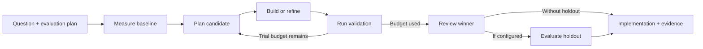
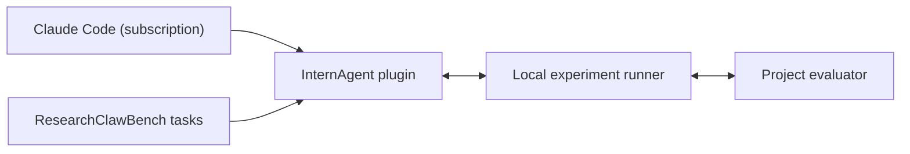

# InternAgent for Claude Code

[](https://code.claude.com/docs/en/plugins)
[](https://nodejs.org/)
[](https://github.com/rexkwoncode/internagent-claude/actions/workflows/tests.yml)
[](LICENSE)

**Design, run, and reproduce research experiments in Claude Code.** Start with a question, an implementation to compare, or a paper to reproduce. InternAgent helps define the experiment, test hypotheses, and retain the evidence so you can resume. Use your existing Claude subscription sign-in with no API key.

[Quickstart](#quickstart) · [Architecture](#architecture) · [Commands](#commands) · [Task catalog](#task-catalog) · [Your own task](#prepare-an-experiment) · [Agent models](#persistent-model-settings) · [Contributing](#contributing)

## How it works



The search starts with independent drafts, refines promising candidates, and can debug failed trials or combine complementary changes. Each trial saves its source, measured score, parent candidates, and evaluator logs. You can resume after closing Claude Code.

## Architecture



Claude Code handles inference and runs the [plugin's skills](skills/) and [agents](agents/). InternAgent routes each task to an experiment, literature research, or paper reproduction. For scored experiments, the [local runner](scripts/run.mjs) executes the evaluator and uses the [MLEvolve-style scheduler](scripts/search.mjs) to select candidate experiments. The [upstream fetcher](scripts/upstream.mjs) retrieves pinned algorithm tasks and paper inputs.

## Quickstart

Install [Claude Code](https://code.claude.com/docs/en/setup) and [Node.js 20+](https://nodejs.org/). Start Claude Code from your project directory, then add the marketplace and install the plugin.

```text
/plugin marketplace add https://github.com/rexkwoncode/internagent-claude.git
/plugin install internagent@internagent-claude
```

The marketplace is publicly available over HTTPS. Anyone can install the plugin without a GitHub account. Model calls use your Claude Code sign-in.

The same install is available from a shell.

```shell
claude plugin install internagent --marketplace https://github.com/rexkwoncode/internagent-claude.git
```

For subscription use, check that `claude auth status` reports `authMethod: claude.ai`. If your shell normally sets an Anthropic API key or uses a custom provider, launch from a shell configured for Claude subscription sign-in. The plugin inherits Claude Code's authentication, model, usage limits, and permissions.

Try a catalog task, start from your own objective, or ask a research question inside Claude Code.

```text
/internagent:discover list
/internagent:build Compare two priority queue implementations on mixed insert and extract workloads.
/internagent:research When does a cache-oblivious layout improve search performance?
```

To update, refresh the marketplace in `/plugin` and update `internagent@internagent-claude` from the Installed tab. For local development, clone the repo and launch `claude --plugin-dir /path/to/internagent-claude`.

## Commands

| Command | What it does |
| --- | --- |
| `/internagent:run demo` | Fit a nonlinear synthetic regression with five trials and a fixed holdout. It uses only Node.js for training and scoring. |
| `/internagent:build <research objective>` | Set up and run an experiment using your question, project, and constraints. |
| `/internagent:run <task.json> [run-directory]` | Run a prepared experiment using its fixed evaluator and seed. |
| `/internagent:run resume <run-directory>` | Continue from the recorded trial state in another session. |
| `/internagent:configure` | Choose and save Claude agent model defaults interactively. |
| `/internagent:discover <list\|task-id\|task-folder> [arguments]` | Find and run a catalog task, upstream discovery experiment, or paper reproduction. |
| `/internagent:research <question>` | Answer a research question and prepare evidence-based hypotheses. |
| `/internagent:reproduce <task-folder> [output-directory]` | Reproduce a study with local data and map the resulting evidence to the benchmark checklist. |

### Run from a script

A scripted run can use Claude Code print mode from a trusted project directory. Use your usual Claude Code project permission rules for Agent, edits, and the runner. For example, this PowerShell command enables edits and authorizes the one runner path for a bundled demo.

```powershell
$plugin = (Resolve-Path "C:/path/to/internagent-claude").Path.Replace('\', '/')
$runner = 'node "' + $plugin + '/scripts/run.mjs" *'
claude -p "/internagent:run demo .internagent/demo" --plugin-dir $plugin --permission-mode acceptEdits --allowedTools Agent "Bash($runner)" "PowerShell($runner)"
```

## Task catalog

```text
/internagent:discover list
```

### Local additions

These research tasks are maintained in this plugin’s [local catalog](catalog/local-tasks.json).

| Task | Workflow |
| --- | --- |
| [AlgorithmEngineering](docs/algorithm-engineering.md) | Design, analyze, implement, and measure competing approaches to an algorithmic problem. |

<a name="upstream-task-catalog"></a>

### Upstream tasks

This group contains 13 discovery tasks from the [pinned InternAgent revision](upstream/revisions.json) and 40 [ResearchClawBench paper tasks](upstream/researchclawbench-task-index.json). The plugin fetches the selected task on demand. You can also point it at a task folder in an existing checkout.

```text
/internagent:discover AutoDebug
/internagent:discover Astronomy_000
```

| Tasks | Workflow |
| --- | --- |
| AutoChem, AutoCls2D, AutoCls3D, AutoClsSST, AutoDebug, AutoEAP, AutoMem, AutoMolecule3D, AutoPower, AutoTPPR, AutoTTS | Run the local experiment and read the benchmark's `final_info.json` using the [pinned metric mapping](upstream/task-catalog.json). |
| AutoTTRL | Supply a local launcher and metric file. Upstream documents an external TTRL launcher and GPU requirements. |
| AutoDrug | Research the pinned carbon-capture question. The pinned task provides a prompt and references to tools, with no runnable baseline or scoring contract. |
| ResearchClawBench task IDs | Reproduce the paper and review the artifacts against its checklist. |

Each task has its own dependencies, such as datasets, checkpoints, Python packages, GPUs, or local inference servers. Some upstream evaluators expect a separate inference endpoint. Claude subscription sign-in covers the plugin agents. Use the task's upstream README to set up the evaluator.

The pinned AutoMolecule3D launcher references a ViSNet YAML file supplied outside its code snapshot. Point the validation command at a local copy when preparing that task.

For a machine-specific launcher, pass an options JSON file as the second argument to `/internagent:discover`. For example, this uses the upstream AutoDebug experiment in a local Python environment.

```json
{
  "validation": {
    "argv": ["C:/experiments/env/Scripts/python.exe", "code/experiment.py"],
    "cwd": ".",
    "resultFile": "final_info.json",
    "metricPath": ["mse"]
  },
  "trials": 3,
  "timeoutSeconds": 120
}
```

`cwd` and `resultFile` are relative to the candidate's evaluation workspace. A command can use `{launcher}` for the pinned launcher path, `{output}` for the per-evaluation output folder, or `{workspace}` for the evaluation workspace. Set `metric` and `direction` if you need to override the catalog. To configure an independent holdout, add a `holdout` object with its own evaluation command or split arguments. Upstream benchmark scores used to select candidates are reported as search scores.

<a name="prepare-a-model-task"></a>

## Prepare an experiment

Put `task.json`, the trusted evaluator, and a small `seed` directory in a project folder. Keep large inputs, symbolic links, and language environments outside the seed. The runner copies the seed and candidate source trees. This example compares simulation error against a reference solution.

```json
{
  "objective": "Reduce simulation error on a fixed set of test cases.",
  "seed": "seed",
  "metric": "rmse",
  "direction": "minimize",
  "validation": ["node", "evaluate.mjs"],
  "holdout": ["node", "evaluate.mjs"],
  "trials": 6,
  "timeoutSeconds": 600
}
```

Each command is an executable followed by arguments. It runs from the task JSON's directory with these environment variables.

| Variable | Purpose |
| --- | --- |
| `INTERNAGENT_CANDIDATE` | Absolute path to the candidate implementation. |
| `INTERNAGENT_OUTPUT` | Directory for measurements, logs, and artifacts for this phase. |
| `INTERNAGENT_METRICS` | File the evaluator writes with a JSON object such as `{"rmse": 1.23}`. The primary value must be finite. |
| `INTERNAGENT_PHASE` | `validation` or `holdout`. Use this to select the fixed workloads or evaluation inputs. |

The evaluator owns input selection, measurement, and artifact export. The candidate implements the interface under study. A trusted task can execute local project code with the current user permissions. Keep the evaluation protocol and input selection fixed while comparing candidates. If you configure a holdout, run a separate command or use the phase variable to select independent inputs.

The default run directory is `.internagent/runs/<id>` under the current project. Each run contains a seed snapshot, `state.json`, and `trials/<id>/candidate` and `trials/<id>/validation`. The winning trial may also have a `holdout` directory. The Claude Code orchestrator writes `report.md`. Measured validation scores determine the winner. Ties favor the earlier trial. Trial budget includes the baseline and failed trials.

The runner can also be inspected directly.

```text
node <plugin>/scripts/run.mjs status <run>
node <plugin>/scripts/run.mjs next <run>
node <plugin>/scripts/run.mjs evaluate <run> <trial-id> "<experiment note>"
node <plugin>/scripts/run.mjs finish <run>
```

Use one Claude Code session per run. If a process was force-terminated and the run still contains `.lock`, check that the recorded process ID and its evaluator are stopped before removing that lock file. Then resume normally. If validation fails on the baseline, repair the environment or task contract and start a fresh run so the new comparison uses a clean baseline.

## Persistent model settings

Run `/internagent:configure` inside Claude Code to choose a scope, role, and Claude model. InternAgent reads the saved settings automatically when you start an experiment.

You can also save this example as `~/.claude/internagent.json` for your user account or as `internagent.config.json` in the project root for a specific project.

```json
{
  "models": {
    "default": "haiku",
    "builder": "sonnet"
  }
}
```

This runs the planner and reviewer on Haiku and the builder on Sonnet. For an individual task, add the same `models` object to its `task.json`. For each role, InternAgent checks the task, project, then user config, stopping at the first layer with a role setting or a `default`. Within that layer the role setting wins. A run saves the resolved aliases so resume uses the same policy even if your config files change. If you set `CLAUDE_CONFIG_DIR`, put the user file there.

Supported values are `haiku`, `sonnet`, `opus`, `fable`, and `inherit`. With `inherit` or no configured value, that role uses the Claude Code session's model. Set the coordinator separately with `/model` or the `claude --model` flag. Claude Code determines model availability and counts usage against your plan. The task's `trials` setting controls how many experiments run.

## Upstream components

- **InternAgent** supplies the discovery workflow pattern. The native skills implement research questions, hypothesis-driven experiments, evaluation, and reuse of recorded results. The runner retrieves relevant successes and failures from project-local trial histories using keyword overlap. The native port uses JSON task specs and Claude Code tools. Upstream YAML launchers, service integrations, and embedding memory remain part of the original Python distribution.
- **MLEvolve** is a Git submodule pinned under `upstream/MLEvolve/`. The subscription workflow uses the native search scheduler and Claude Code agents for independent drafts, progressive exploration, improvements, debug retries, and cross-branch fusion. The upstream Python entry point has its own dependencies and provider configuration.
- **ResearchClawBench** is a Git submodule pinned under `upstream/ResearchClawBench/` at the same commit as InternAgent's `sci_tasks`. The plugin's lightweight task index ships separately. The reproduction skill uses the selected paper, dataset, and checklist to produce an evidence review.

The [submodule URLs](.gitmodules) and [runtime fetch pins](upstream/revisions.json) identify the upstream sources. Plugin installs and ZIP archives contain the native workflow and task index. To check out the upstream source in a Git clone, initialize the submodule you need.

```shell
git submodule update --init upstream/MLEvolve
git submodule update --init upstream/ResearchClawBench
```

The full ResearchClawBench checkout includes all benchmark assets. Fetch an individual task if you only need its inputs.

The plugin includes a pinned fetcher that uses Git and public GitHub access. To reproduce a task, first fetch into your project, then launch its skill from that project.

```powershell
node "C:/path/to/internagent-claude/scripts/upstream.mjs" ResearchClawBench ".internagent/ResearchClawBench" Astronomy_000
```

```text
/internagent:reproduce .internagent/ResearchClawBench/tasks/Astronomy_000
```

Omit the final task name to fetch the full benchmark. Some tasks require additional datasets or dependencies. Use a separate destination when fetching a different sparse task. InternAgent and MLEvolve source checkouts can also be created by passing their names and a destination to the fetcher.

## Contributing

Work on a branch and run the checks from the repository root before opening a pull request. Include a minimal task spec or reproducible fixture for workflow changes. Keep datasets, credentials, and experiment outputs in your local project.

```powershell
claude plugin validate --strict .claude-plugin/marketplace.json
claude plugin validate --strict .claude-plugin/plugin.json
node --test
```

The [test workflow](.github/workflows/tests.yml) runs the offline suite on Windows and Linux. The [bundled regression task](examples/regression/) exercises the full Claude Code workflow.

## License and credits

The native port is available under [Apache-2.0](LICENSE). See [NOTICE](NOTICE) for attribution and the licenses of the pinned upstream components.
