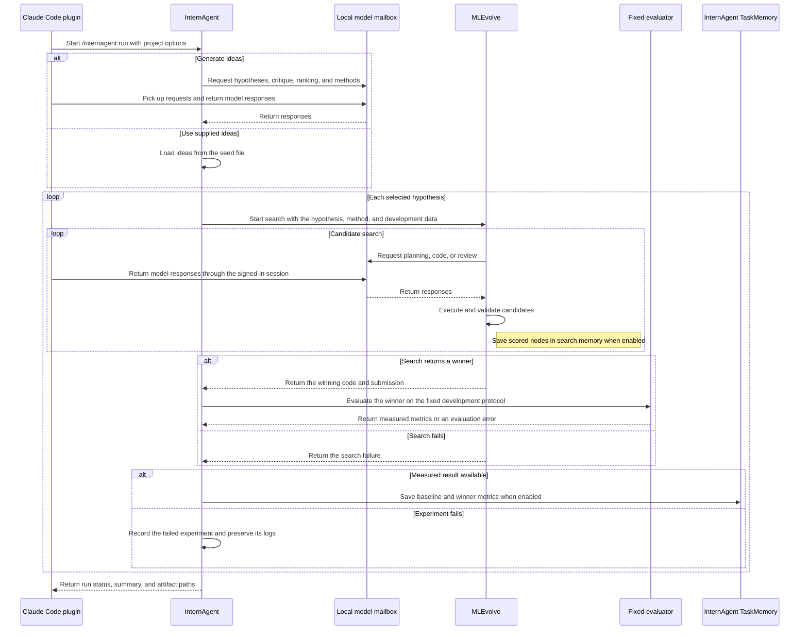

# ML search sequence

`/internagent:run` loads project options with `engine: "InternAgent"` and a nested `mlevolve` configuration. InternAgent owns the research loop. MLEvolve runs a separate candidate search for each selected hypothesis. Both engines use the same signed-in Claude Code session for inference. [Configure the backend](upstream-runtime.md#mlevolve-as-internagents-ml-backend).

In incremental mode, InternAgent can carry the winning code and measured baseline into the next round. MLEvolve receives that code as a reference. A final holdout can be scored separately after selection.
