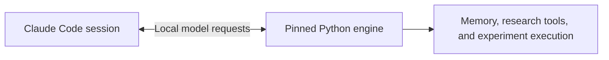

# Run the upstream engines from Claude Code

`/internagent:run` uses the original pinned Python workflow by default. Pass a catalog task, task folder, or options file. Save options as `internagent-upstream.json` in the project root to run them without arguments. `/internagent:upstream` is an alias. Use `/internagent:lightweight` for the Node.js runner.



The command calls the native Claude Code Agent tool for model requests from the registered InternAgent provider and MLEvolve's generation and query functions. Your Claude Code session handles authentication. Python writes model requests to local files and reads the answers. InternAgent's configured research tools and evaluators run on the Python side. Its `claudecode` experiment backend delegates workspace edits to the plugin's Claude Code builder.

## Prepare the runtime

Use the pins in [upstream/revisions.json](../upstream/revisions.json). In a Git clone, run `git submodule update --init upstream/InternAgent upstream/MLEvolve upstream/ResearchClawBench`. In a marketplace installation, use `scripts/upstream.mjs` to download the same revisions into your project. Point the launcher at full source checkouts for the engines.

Install the Python requirements documented by the selected engine in a virtual environment with the dependencies for the selected task. Benchmarks can also need a Unix shell, datasets, Graphviz, training libraries, or compatible accelerators. Paths inside `args` are interpreted by the upstream launcher. Use absolute paths for task folders, results, and resume directories.

On Windows, InternAgent uses Git Bash for its benchmark launchers. Set `CLAUDE_CODE_GIT_BASH_PATH` if your Git Bash is installed outside the standard location. For MLEvolve, install `psutil` and use `copy_data=true` when symlinks are unavailable. Benchmark launchers that require Linux can run in a Claude Code session started inside WSL.

### InternAgent

Omit `config` to use the pinned engine defaults with Claude Code inference, saved model preferences, and local embeddings. To customize the workflow, copy `config/default_config.yaml` into the project and set the following fields in that copy. Existing per-agent `model_provider` values can select another configured provider. An agent using `default` follows `models.default_provider`.

```yaml
models:
  default_provider: claude-code
  claude-code:
    model_name: opus
agents:
  exp_analyze:
    provider: claude-code
    model_name: opus
experiment:
  model: opus
```

For local task memory, set `memory.task_memory.embedding.model_type` to `local` and `model_name` to a local Sentence Transformers path or a downloadable model. Long memory uses the upstream Chroma and NetworkX idea graph with Chroma's default local encoder. Install `chromadb`, `networkx`, and `pyclustering` if they are absent from the selected environment. The first run downloads the local encoder into the upstream run directory's parent. Use a fresh memory directory or a separate task namespace when migrating a graph with existing OpenAI vectors. Embeddings from different models cannot share a collection.

Write an options JSON file in your project and invoke `/internagent:run internagent-upstream.json`.

```json
{
  "engine": "InternAgent",
  "checkout": ".internagent/upstream/InternAgent",
  "python": "C:/research/internagent-venv/Scripts/python.exe",
  "config": "internagent-upstream.yaml",
  "args": [
    "--task", "C:/research/tasks/AutoDebug",
    "--output_dir", "C:/research/results/autodebug",
    "--exp_backend", "claudecode"
  ]
}
```

The original launcher also accepts `--resume`, `--offline_feedback`, `--skip_idea_generation`, `--idea_path`, and report mode. Run its `--help` for the full argument list.

### MLEvolve

Use a MLEvolve configuration and the original Hydra-style arguments. Set `agent.code.model` and `agent.feedback.model` to Claude aliases when you want explicit per-role models. Otherwise the plugin maps its bundled model names to the configured builder and planner models.

```json
{
  "engine": "MLEvolve",
  "checkout": ".internagent/upstream/MLEvolve",
  "python": "C:/research/mlevolve-venv/Scripts/python.exe",
  "args": [
    "desc_file=C:/research/tasks/my-task/description.md",
    "data_dir=C:/research/tasks/my-task/data",
    "exp_name=my-task",
    "agent.code.model=opus",
    "agent.feedback.model=opus"
  ]
}
```

See the engine's [configuration and task instructions](https://github.com/InternScience/MLEvolve/tree/77cf997b35c0f3b40a95a0b9607bef6ea9f576b6#quick-start) for task scoring, worker configuration, hardware, and model checkpoints. Launch MLEvolve using `/internagent:run mlevolve-upstream.json`.

## Provider coverage

The Claude Code provider supports text, JSON, and upstream tool selection. Claude Code owns model controls, and provider-specific sampling and token settings are advisory. The plugin preserves the upstream settings for parallelism, compute, evaluator, feedback, and checkpointing.

Some InternAgent integrations use separate clients outside its model factory. To select the Claude Code bridge for the embedded DR workflow, set `agents.dr.model_provider` to `claude-code` and optionally set its `model_name`. For the original ResearchClawBench judge, initialize InternAgent's nested `sci_tasks` submodule and set `sci_task.scorer_model` to a Claude alias. The judge adapter forwards the official checklist prompts and attached images. Third-party literature services and MCP servers use their own credentials when required.
